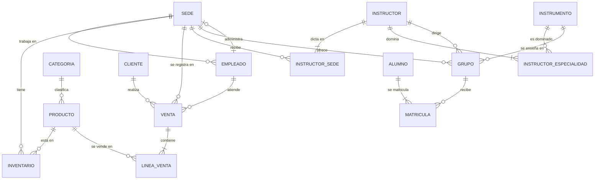

# Cómo se conectan las tablas

## Diagrama

## Las 19 claves foráneas

Cada fila indica qué columna se iguala con cuál para unir dos tablas.

| # | Tabla origen | Columna | Apunta a | Cardinalidad |
|---|---|---|---|---|
| 1 | empleado | id_sede | sede.id_sede | N:1 |
| 2 | sede | id_administrador | empleado.id_empleado | 1:1 |
| 3 | producto | id_categoria | categoria.id_categoria | N:1 |
| 4 | inventario | id_sede | sede.id_sede | N:1 |
| 5 | inventario | id_producto | producto.id_producto | N:1 |
| 6 | venta | documento_cliente | cliente.documento | N:1 |
| 7 | venta | id_sede | sede.id_sede | N:1 |
| 8 | venta | id_vendedor | empleado.id_empleado | N:1 |
| 9 | linea_venta | id_venta | venta.id_venta | N:1 |
| 10 | linea_venta | id_producto | producto.id_producto | N:1 |
| 11 | instructor_especialidad | id_instructor | instructor.id_instructor | N:1 |
| 12 | instructor_especialidad | id_instrumento | instrumento.id_instrumento | N:1 |
| 13 | instructor_sede | id_instructor | instructor.id_instructor | N:1 |
| 14 | instructor_sede | id_sede | sede.id_sede | N:1 |
| 15 | grupo | id_sede | sede.id_sede | N:1 |
| 16 | grupo | id_instructor | instructor.id_instructor | N:1 |
| 17 | grupo | id_instrumento | instrumento.id_instrumento | N:1 |
| 18 | matricula | documento_alumno | alumno.documento | N:1 |
| 19 | matricula | id_grupo | grupo.id_grupo | N:1 |

## Columnas cuyo nombre no coincide con la que referencian

Estas son las uniones donde el nombre de la columna cambia de una tabla a otra:

| Columna | Se une con |
|---|---|
| venta.documento_cliente | cliente.documento |
| venta.id_vendedor | empleado.id_empleado |
| sede.id_administrador | empleado.id_empleado |
| matricula.documento_alumno | alumno.documento |

## Columnas que existen en varias tablas con el mismo nombre

Al unir estas tablas, hay que indicar de cuál tabla viene la columna:

| Columna | Tablas |
|---|---|
| id_sede | sede, empleado, inventario, venta, instructor_sede, grupo |
| nombre | sede, categoria, producto, instrumento |
| documento | empleado, cliente, instructor, alumno |
| primer_nombre, apellidos, telefono | empleado, cliente, instructor, alumno |
| correo | empleado, cliente, alumno |
| estado | grupo, matricula |
| id_producto | producto, inventario, linea_venta |
| id_instructor | instructor, instructor_especialidad, instructor_sede, grupo |
| id_instrumento | instrumento, instructor_especialidad, grupo |

## Caminos entre tablas

Tablas que no están conectadas directamente y por cuáles hay que pasar:

| Desde | Hasta | Pasando por |
|---|---|---|
| cliente | producto | venta → linea_venta |
| cliente | categoria | venta → linea_venta → producto |
| empleado (vendedor) | producto | venta → linea_venta |
| sede | producto | inventario, o venta → linea_venta |
| alumno | grupo | matricula |
| alumno | instructor | matricula → grupo |
| alumno | sede | matricula → grupo |
| alumno | instrumento | matricula → grupo |
| instructor | instrumento | instructor_especialidad (lo que domina) o grupo (lo que enseña) |
| instructor | sede | instructor_sede (donde puede dictar) o grupo (donde dicta) |
| cliente | alumno | se relacionan por el mismo documento; no hay FK |

## Relaciones sin participación total

Estas filas existen en los datos sin pareja en la otra tabla:

| Caso | Datos |
|---|---|
| Clientes sin ventas | Juan Pablo (1001234567) y Tomás (1036987654) |
| Productos sin inventario | PRD-06 y PRD-13 |
| Productos sin ventas | PRD-08 y PRD-13 |
| Instructores sin grupos | INT-06 |
| Grupos sin matrículas | GR-07 |
| Personas que son cliente y alumno | 43987123 (Patricia) |
